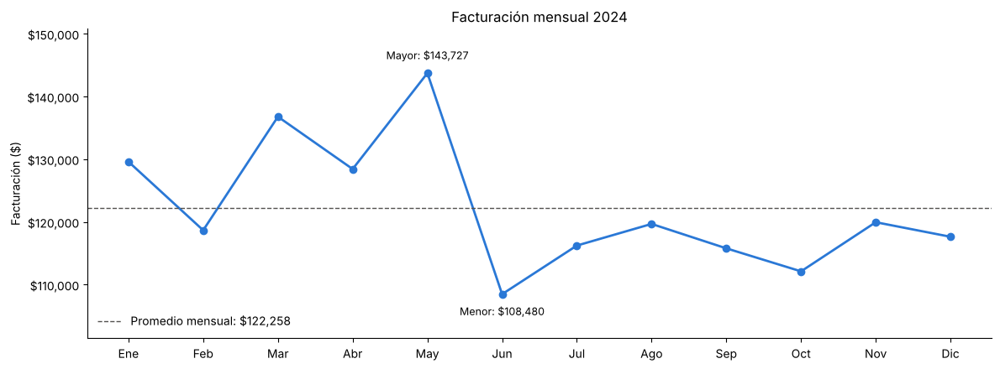
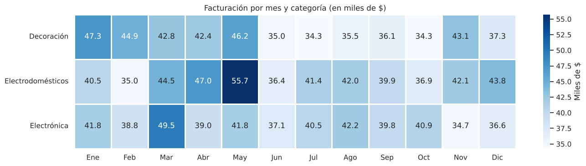
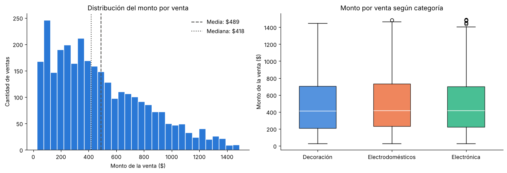
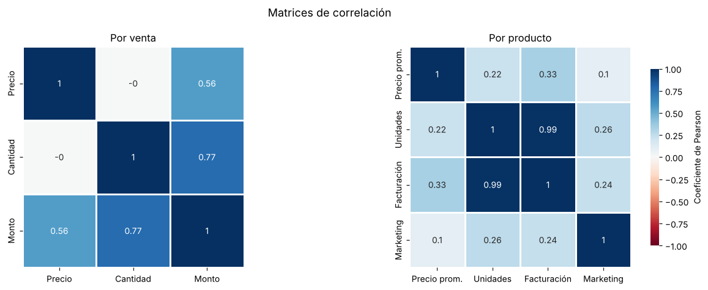
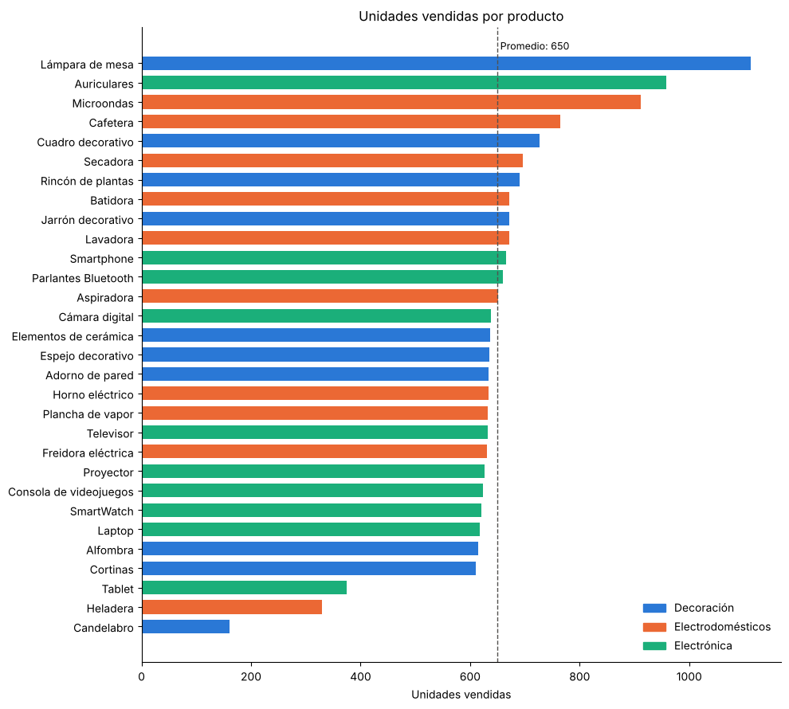

# Análisis de ventas de un e-commerce

Análisis completo de las ventas 2024 de un e-commerce de decoración, electrodomésticos y electrónica: desde la limpieza de los datos hasta un dashboard interactivo, con foco en encontrar qué se vende, cuándo y qué factores influyen en las ventas.

Proyecto final integrador del curso de **Análisis de Datos de Talento Tech**, planteado como la evaluación de una pasantía en la empresa ficticia *SynthData*.

**Herramientas:** Python · Pandas · NumPy · Matplotlib · Seaborn · Plotly · Google Colab

## Hallazgos principales

- **Facturación anual de $1.467.093** en 2.998 ventas, con un ticket promedio de $489. Las tres categorías (Decoración, Electrodomésticos y Electrónica) aportan partes casi iguales.
- **El primer semestre vendió más que el segundo.** Mayo fue el mejor mes ($143.727, impulsado por Electrodomésticos) y junio el peor (−24,5 %, con caída en todas las categorías).
- **El precio no influye en la cantidad comprada** (r = 0,00). El monto de cada venta depende más de las unidades (r = 0,77) que del precio (r = 0,56), por lo que impulsar compras de más unidades sería más efectivo que vender productos más caros.
- **La inversión en marketing tiene un efecto débil** sobre las ventas (r = 0,26).
- **Candelabro, Heladera y Tablet** venden menos de la mitad que el resto de los productos y tienen meses sin ninguna venta, lo que apunta a un posible problema de stock más que de demanda.





## Qué se hizo

El proyecto está organizado en cuatro etapas, todas en el notebook [`notebooks/Proyecto.ipynb`](notebooks/Proyecto.ipynb).

### 1. Recopilación y preparación
Carga de los tres datasets (ventas, clientes y marketing), análisis exploratorio inicial con Pandas y diagnóstico de calidad: 35 registros duplicados, 4 valores nulos, precios guardados como texto con el símbolo `$` y fechas como texto.

### 2. Limpieza y transformación
- Eliminación de duplicados y nulos, limpieza de espacios y conversión de tipos.
- Tabla de **productos de alto rendimiento** (los que superan el promedio de unidades vendidas).
- Ingresos por categoría.
- Integración de ventas con marketing, resolviendo la duplicación de filas que genera la relación uno a muchos (cada producto tiene 3 campañas).

### 3. Análisis de datos
- **Estadística descriptiva** del precio, la cantidad y el monto de cada venta, de la facturación mensual y por categoría, con detección de valores atípicos por el criterio del rango intercuartílico.
- **Análisis exploratorio** con visualizaciones: distribución de montos, evolución mensual, día de la semana y ranking de productos.
- **Correlación** entre precio, cantidad, monto e inversión en marketing.
- **Consolidación** de los resultados en tablas finales ([`data/processed`](data/processed)).





### 4. Visualización
- **Matplotlib:** ventas por día, semana, mes y trimestre.
- **Seaborn:** violín, densidad, mapa de calor, regresión y barras con intervalos de confianza, con una paleta propia por categoría.
- **Plotly:** dashboard interactivo con filtro por categoría (actualiza los 4 gráficos y los indicadores clave) y un gráfico de facturación diaria con selector de período.
- **Resumen final** con los hallazgos y recomendaciones de negocio.



## Recomendaciones

1. Revisar el stock y la disponibilidad de Candelabro, Heladera y Tablet.
2. Impulsar compras de más unidades con promociones por cantidad o combos.
3. Planificar acciones comerciales para el segundo semestre, especialmente para Decoración, y analizar la caída de junio.
4. Medir el resultado de cada campaña por canal antes de aumentar la inversión en marketing.

## Estructura del repositorio

```
├── data/
│   ├── raw/              Datasets originales (ventas, clientes y marketing)
│   └── processed/        Tablas consolidadas generadas en el análisis
├── images/               Gráficos principales
├── notebooks/
│   └── Proyecto.ipynb    Notebook con todo el análisis
├── requirements.txt
└── README.md
```

## Cómo ejecutarlo

El notebook está pensado para **Google Colab** y lee los datos desde Google Drive.

1. Abrí el notebook en Colab (desde GitHub: *Archivo → Abrir notebook → GitHub*).
2. Subí los archivos de `data/raw/` a una carpeta de tu Google Drive.
3. En la celda de carga, cambiá la variable `ruta` por la ubicación de esa carpeta.
4. Ejecutá todas las celdas (*Entorno de ejecución → Ejecutar todas*).

Para ejecutarlo en local, instalá las dependencias con `pip install -r requirements.txt`, saltá las celdas de Google Drive y apuntá `ruta` a `data/raw/`.

> **Nota:** el gráfico interactivo de Plotly no se ve en la vista previa de GitHub. Para usarlo, hay que ejecutar el notebook.

## Datos

Los datasets fueron provistos por el curso con fines educativos.

---

**Agustina Torres** · [Portfolio](https://agtorres1.github.io) · [GitHub](https://github.com/agtorres1)
